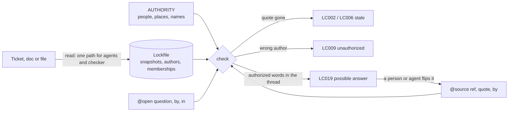

# Contributing to live-comments

Everyone is welcome: use cases, extractors for new tools, bug reports, and disagreements with the [spec](SPEC.md).

## Setup

```sh
pnpm install
pnpm build
pnpm test
```

The CLI tests run the built CLI in a throwaway git repository, so run `pnpm build` before `pnpm test`.

## How it works



- **Sources** are read through a resolver per tool. External tools go through [Composio](https://composio.dev) or [Nango](https://nango.dev), which handle authentication, and an extractor that turns the tool's raw API response into text with authors. Extractors read each tool's own API format, so every extractor works over either platform. GitHub and Linear extractors ship today; repository files are attributed with `git blame`.
- **Normalization** strips formatting the same way for sources and quotes, so a quote copied from `read` output always matches.
- **The lockfile** snapshots every source and group membership, so `check` runs offline and upstream changes show up as reviewable diffs.
- **Tests.** Alongside unit and property tests, a model-based test drives random sequences of source edits, membership changes, quote changes and syncs, and checks every intermediate state against an independent reference model.

## Layout

| Path | |
|---|---|
| `packages/core/src/annotations` | Parsing `@source` and `@open` tags from TypeScript |
| `packages/core/src/authority` | The `AUTHORITY` language: syntax, file, evaluation |
| `packages/core/src/sources` | Resolvers, transports (Composio, Nango), extractors per tool |
| `packages/core/src/lifecycle` | Evaluating comments, comparing against a base, sync impact |
| `packages/core/src/workflows` | The I/O behind each command |
| `packages/cli` | The CLI, `init` and the MCP server |
| `packages/eslint-plugin` | The ESLint rule |
| `skills/` | The agent skill and the `AGENTS.md` snippet |

Adding a tool means adding an extractor in `packages/core/src/sources/providers/`: a small function from the tool's raw API responses to text segments with their authors, plus fixtures and tests.
