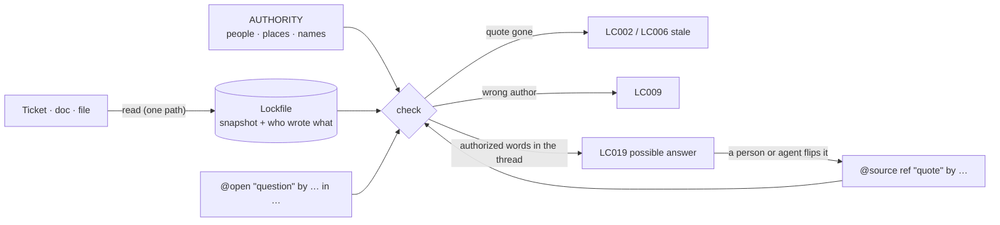

<p align="center">
  <picture>
    <source media="(prefers-color-scheme: dark)" srcset="docs/assets/bicameral-lockup-dark.svg">
    
  </picture>
</p>

<h1 align="center">live-comments</h1>

<h3 align="center">Comments tracked to their source, so your agents don't make up the rules.</h3>

<p align="center">
  Every business rule in your code cites the ticket, doc or file it came from.<br>
  Every rule nobody has decided yet is marked as an open question, and stays open until someone with authority answers it.
</p>

<p align="center">
  <a href="LICENSE"></a>
  
  <a href="skills/live-comments/SKILL.md"></a>
  
  
</p>

<p align="center">
  <a href="#quick-start"><b>Quick start</b></a> ·
  <a href="#how-it-works"><b>How it works</b></a> ·
  <a href="SPEC.md"><b>Spec</b></a> ·
  <a href="skills/live-comments/SKILL.md"><b>Agent skill</b></a> ·
  <a href="#contributing"><b>Contributing</b></a>
</p>

---

```ts
/** @source linear:ENG-142 "Only the best single discount applies per order" by pricing */
export function applyDiscounts(codes: Code[]): Price { … }

/** @open "Do discount codes stack with gift cards?" by pricing in linear:ENG-188 */
export function applyGiftCard(card: GiftCard, total: Price): Price { … }
```

`live-comments check` confirms the quote is still in ENG-142, that the person who wrote it is on the pricing team, and that the gift-card rule is still waiting on an answer. When someone on the pricing team answers in ENG-188, `sync` shows you their words, and the `@open` becomes a `@source`.

## Why

Coding agents fill gaps. When a ticket doesn't say whether discount codes stack, an agent picks an answer, writes plausible code, and the tests pass. Nobody decided that rule. It just shipped.

Comments don't help, because nothing checks them. They go stale the day the ticket changes, and they can't say "this hasn't been decided."

Live comments fix both:

- **Bound to the source.** A `@source` cites a ref, optionally a verbatim quote, optionally who must have written it. The checker verifies all three, with no model in the loop.
- **Open questions are explicit.** An `@open` is a typed hole for a product decision: it records that a rule is undecided, who should decide it, and where the answer should come from. Agents are told never to fill it themselves.
- **Authority comes from people.** Who counts as `pricing` is defined once, in a governed `AUTHORITY` file that code can't change. Agents and bots never hold authority.

## The `@open` tag

Most tools can only describe decisions that were made. `@open` describes one that wasn't:

```ts
/** @open checkout.gift-cards "Do gift cards stack with discounts?" by pricing in linear:ENG-188 options "yes" | "no, applied after" */
```

- **It is a hole, not a TODO.** The checker lists every open question with who should answer it. A governed export can't silently drop it.
- **It can't be filled by guessing.** It becomes a `@source` only by citing words that someone matching `by` wrote. With `sticky` on, the `by` and `in` carry over, so the authority requirement survives the answer.
- **Answers find you.** When an `@open` points at a thread, `sync` reports every passage written there by someone who could answer it (LC019). Deciding whether it actually answers the question is left to a person or an agent.

## Quick start

Tell your coding agent:

> Set up live-comments from github.com/BicameralAI/live-comments

Or do it yourself:

```sh
npx live-comments init                  # config, AUTHORITY, the agent skill, MCP setup
npx live-comments connect github        # through Composio (or --via nango)
npx live-comments sync                  # read every cited source into the lockfile
npx live-comments check                 # verify; exits non-zero on errors
```

`init` installs the agent skill in `.agents/skills/` and in each agent folder your project already has (Claude Code, Cursor, Copilot), and registers the `live-comments` MCP server. Agents then read sources through `read_source`, which is the exact text the checker verifies, so their quotes always match.

In CI:

```yaml
- name: Check live comments
  run: npx live-comments check --base origin/${{ github.base_ref || 'main' }}
```

With `--base`, the check also reports every authority change in the pull request, such as `by pricing → by eng`, so reviewers see who is deciding what even in a large diff.

## How it works



- **Sources** are read through a resolver per tool. External tools use a transport (Composio or Nango) for authentication and an extractor that turns the tool's API response into text with authors. GitHub and Linear extractors ship today; repository files are attributed with `git blame`.
- **Normalization** strips formatting the same way for sources and quotes, so a quote copied from `read` output always matches.
- **The lockfile** snapshots every source and group membership, so `check` runs offline and source changes show up as reviewable diffs.
- **Status is computed, never stored.** A comment's state is a function of the code, the lockfile, `AUTHORITY` and the config, so the same inputs always give the same answer.

## `AUTHORITY`

```
jdoe          = github:jdoe | linear:usr_8f2 | email:jdoe@acme.com
agent claude  = github:acme-claude[bot]
pricing       = jdoe | members(linear:team/PRICING)
pricing-desk  = linear:team/PRICING | notion:space/Pricing
pricing-call  = pricing in pricing-desk
launch-call   = pricing-call & legal
```

A vocabulary of names, not a map of owners: which name applies is written on each rule with `by`. `|` means either, `&` means both, `in` restricts where the words were written. See [SPEC.md §7](SPEC.md#7-authority).

## Commands

| Command | |
|---|---|
| `init` | Scaffold config, `AUTHORITY`, the skill and MCP setup |
| `check [--base <rev>]` | Verify annotations; report authority changes against a base |
| `sync` | Re-read cited sources and memberships; report stale quotes and answer candidates |
| `read <ref>` | Read one source through the checker's path, for quoting |
| `context <file>:<line>` | Facts an agent needs before annotating (JSON) |
| `who <expr>` · `authority` | Expand authority names into people and places |
| `directory <system>` | A connected tool's accounts and places, with exact ids |
| `report` | Open questions and coverage per governed area |
| `connect <system>` | Connect a tool through Composio or Nango |
| `mcp` | Serve `read_source`, `context`, `who`, `authority`, `directory` |

## Packages

| Package | |
|---|---|
| [`live-comments`](packages/cli) | The CLI and MCP server |
| [`@live-comments/core`](packages/core) | Annotations, authority, sources and lifecycle, built on [Effect](https://effect.website) |
| [`eslint-plugin-live-comments`](packages/eslint-plugin) | The file-local checks as an ESLint rule, for editor feedback |

## Live comments and Bicameral

Live comments share Bicameral's rule that **no product decision is made without human supervision**, and cover a narrower job. Live Comments binds each comment to a source and checks who wrote the words it rests on. It does not judge whether that source is still the team's current, ratified decision. Keeping decisions current, superseded or signed off is what [Bicameral](https://github.com/BicameralAI/bicameral) does. The two fit together: Bicameral keeps the decision ledger, and live comments keep the code pointing at it.

## Status

Early preview. What works and is tested:

- Annotation parsing, authority expressions, normalization and the comment lifecycle, covered by unit, property-based and model-based (state machine) tests
- The CLI end to end in a real git repository, including the MCP server
- GitHub sources through the Composio CLI, end to end against a public repository

Not done yet: Notion, Jira and Google Docs extractors; live tests of the Nango transport and the Composio SDK path; languages other than TypeScript. The [spec](SPEC.md) lists the open design questions.

## Contributing

Everyone is welcome. Open an issue with a use case, a missing extractor or a disagreement with the spec.

```sh
pnpm install
pnpm build
pnpm test
```

## License

[MIT](LICENSE)
